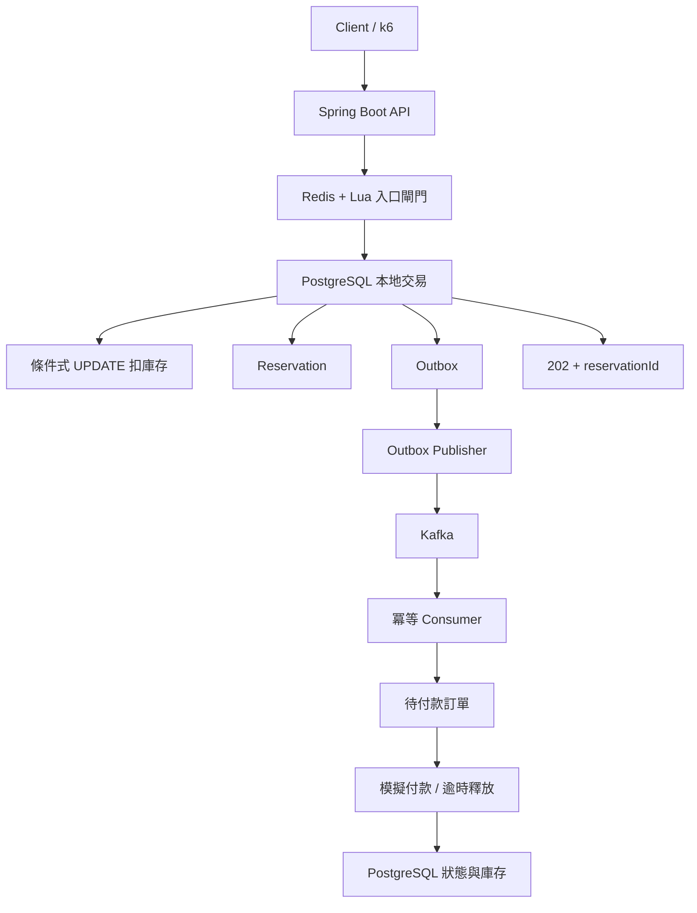

# High-Concurrency Ticketing System · V1–V8

Java 21 · Spring Boot 3.5.16 · PostgreSQL 16 · Redis 7.4 + Lua · Kafka 3.9.1 · k6。

以高併發搶票為題的 Java 後端作品：從 V1 可重現的超賣問題，逐步完成原子扣庫存、Redis 入口閘門、Kafka 非同步建單、模擬付款、逾時釋放、冪等與故障恢復。

**實測結果：17 個整合測試與 8 個核心單元測試通過；在本機 Docker Compose 中，兩份 k6 測試各完成 100,000 次迭代、1,000 VUs。每活動 100 張票，最終旅程有 100 筆付款完成，超賣、重複訂單與庫存差異皆為 0。** 這是單機短測結果，不代表 10 萬同時連線、10 萬 RPS 或生產環境容量保證。

## 專案導覽

| 想了解的內容 | 文件 |
| --- | --- |
| 10 頁專案簡報 | [Gamma 簡報](https://gamma.app/docs/High-Concurrency-Ticketing-System-xi1ylkvvzj07pxg?mode=doc) · [簡報文字備份](docs/presentation.md) |
| Controller → Service → DTO → DB 逐行說明 | [完整 HTML 導讀](docs/v1-v8-code-walkthrough.html)（下載後以瀏覽器開啟） |
| 系統架構與資料流程 | [架構文件](docs/architecture.md) |
| API 路徑與資料格式 | [OpenAPI 規格](docs/openapi.yaml) |
| 重試、補償與資料一致性 | [Reliability](docs/reliability.md) |
| 測試證據與驗證範圍 | [驗證狀態](VALIDATION.md) · [10 萬次實測](docs/k6-100k.md) · [1,000 次基線](docs/k6-baseline.md) |

Gamma 簡報沿用文件目前的存取設定；若無法開啟，可直接閱讀 repo 內的文字備份。GitHub 會顯示 HTML 原始碼，完整互動導讀需下載開啟。

## 最終架構



PostgreSQL 是最終正確性邊界：扣庫存、預約與 Outbox 在同一交易內提交；Redis 僅作可重建的入口閘門。Kafka 採至少一次投遞，透過 Consumer 冪等處理與資料庫唯一約束避免重複建單。Redis 不可用時改走 DB 原子扣減。

## 10 萬次目標驗收

2026-10-30，在單一本機 Docker 主機上，以 1,000 VUs 分別執行 admission 與完整旅程，各完成 100,000 shared iterations、無中斷，所有 thresholds 通過。兩次測試使用不同活動，各有 100 張初始票。

| 指標 | 結果 |
| --- | --- |
| 接受預約／業務拒絕 | 100／99900 |
| 超賣／重複訂單／庫存差異 | 皆 0 |
| admission P95／P99 | 857.25ms／1190.32ms |
| 完整旅程 | 100 筆付款成功，預約／付款重放與庫存守恆檢查通過 |
| 成功付款旅程 P95／P99 | 12.644s／12.873s（100 筆付款樣本） |
| 執行時間 | admission 35.73 秒；完整旅程 29.17 秒 |
| HTTP 失敗率／旅程錯誤 | 0%／0（售罄 409 視為預期業務回應） |

[10 萬次完整結果與限制](docs/k6-100k.md) · [機器可讀數據](docs/k6-100k-results.json)。Admission P95/P99 計算入口請求延遲；付款旅程 P95/P99 只計 100 筆成功付款樣本，不能直接比較。大量請求是預期售罄回應；不以此宣稱 10 萬併發、10 萬 RPS 或可持續付款 TPS。

## 已完成的本機基線

| 項目 | 實測 |
| --- | --- |
| Java 測試 | 17 個整合測試 + 8 個核心單元測試通過 |
| admission | 100 VUs、1000 次請求，接受 100、業務拒絕 900；超賣／重複訂單／庫存差異皆 0 |
| admission 延遲 | P95 548.90ms、P99 800.35ms |
| 完整旅程 | 100 筆 Kafka 建單與模擬付款成功，重放檢查通過，庫存守恆 |
| 完整旅程延遲 | P95 10.898s、P99 10.907s（100 筆付款樣本） |

[完整基線報告與量測限制](docs/k6-baseline.md)。短測含大量售罄回應，不能解讀成可持續成功訂單 TPS。

## 階段與實作

| 版本 | 實作 | 對照方式 |
| --- | --- | --- |
| V1 Race Condition | JPA read/check/write，50ms 教學延遲 | 預設關閉，啟用後僅活動 1 |
| V2 Atomic SQL | `UPDATE ... SET remaining=remaining-1 WHERE event_id=? AND remaining>0` | `/api/v2/tickets/{event}/reserve`，同步建單 |
| V3 Redis + Lua | 原子檢查與扣減快取庫存，token 去重 | `/api/v3/tickets/{event}/reserve`，同步建單 |
| V4 Kafka | DB outbox → Kafka → 冪等 Consumer | `/api/tickets/{event}/reserve`，202 非同步建單 |
| V5 Order & Payment | QUEUED → PENDING_PAYMENT → PAID／EXPIRED／FAILED | 查詢、模擬付款、定時到期釋放 |
| V6 Reliability | DB 唯一鍵、列鎖、outbox 重送、Consumer retry／DLT、快取與庫存校正 | [故障說明](docs/reliability.md) |
| V7 Load Testing | k6 admission 壓測，JSON 指標輸出，吞吐量、P95／P99、錯誤與庫存守恆 | [壓測說明](docs/load-testing.md) |
| V8 Delivery | Compose、API 規格、架構、驗收腳本、面試說明 | [OpenAPI](docs/openapi.yaml)、[架構](docs/architecture.md) |

上述實作已通過 Java 整合與本機 1000 次基線驗收；也已完成上述 10 萬次目標；長時間穩態與多機測試仍待完成。

## 一鍵啟動

先啟動 Docker Desktop，需有網路下載 Maven 依賴與容器映像。

```bash
cp .env.example .env
docker compose up --build -d --wait --wait-timeout 180 db redis kafka app
curl http://localhost:18080/actuator/health/readiness
curl http://localhost:18080/api/tickets/2
```

預設主機 API 18080、PostgreSQL 5433；Redis／Kafka 只在 Compose 網路中。可用 APP_PORT、POSTGRES_PORT 覆寫。Kafka 的 advertised listener 是容器內 `kafka:9092`，此 Compose 沒有提供主機端 Kafka listener；本機 Java 建議用整合測試的 Testcontainers，或自行配置雙 listener。

資料庫活動 1 保留 V1 實驗；活動 2 初始化 100 張供新版使用。已有 volume 不會重設庫存。Redis、Kafka、PostgreSQL 均配置持久化 volume，但這是單機 demo，不提供 HA。

## 跑一次完整訂單流程

```bash
curl -i -X POST http://localhost:18080/api/tickets/2/reserve \
  -H 'Content-Type: application/json' -H 'Idempotency-Key: demo-001' \
  -d '{"userId":"demo-user"}'
```

HTTP 202 回傳 `id`、`eventId`、`userId`、`status`、`expiresAt`。新預約通常是 QUEUED；已重送過的 key 會回傳同一 id 與最新狀態。沒有其他請求時，資料庫剩餘庫存應為 99。**202 表示已持久化保留庫存，還不是付款成功。**

把下列 ID 換成回傳的 UUID：

```bash
curl http://localhost:18080/api/reservations/ID
curl http://localhost:18080/api/orders/ID
curl -X POST http://localhost:18080/api/orders/ID/payment \
  -H 'Content-Type: application/json' -d '{"success":true}'
```

先等到 PENDING_PAYMENT 再付款；尚未建單為 409 ORDER_NOT_READY。`success:false` 表示模擬付款失敗，會釋放一次庫存。付款 body 必須有 boolean success。這不是金流整合，不處理真實款項。

相同 Idempotency-Key、相同 event/user 不會再次扣庫存或建單；變更 payload 回傳 409。同一 key 即使已過期／失敗也保留終態，若要再次購買必須換新 key。key 為全域、最多 128 個 ASCII 字元（英數、點、底線、冒號、連字號）。每次限一張；沒有登入或可信 userId 認證，僅供本機展示。

## 測試與驗收

```bash
mvn -B -f verification/core/pom.xml test
mvn -B verify
bash scripts/acceptance.sh
```

新版 FinalIntegrationTest 需要 PostgreSQL、Redis、Kafka Testcontainers。**沒有 Docker 時要失敗，不得以跳過代表成功**。Dockerfile 只包裝應用（跳過執行測試）；完整測試必須在 build 前透過上面命令執行。

另有 8 個使用 mock DB/cache 的核心單元測試，已在本機通過；它們不驗證真實交易與併發。驗收腳本會先跑這組，再跑整合測試及壓測。

15 個新版整合案例涵蓋：併發不超賣、同 key 只建一單、輸入／admin 邊界、Lua 原子扣減、Kafka 重複訊息、重複付款、付款失敗補償、排隊／待付款到期、付款到期競爭、DLQ、資料修復、Kafka／Redis 中斷復原。另保留 2 個 V1 教學測試。測試碼數量不是已通過數量，實際結果見 VALIDATION.md。

```bash
mkdir -p load-test/results
# 第一次使用未被消耗的活動 2
# 主機結果目錄需可供 k6 容器寫入；以宿主使用者執行避免權限差異。
docker compose run --rm --user "$(id -u):$(id -g)" k6
```

結果存放 `load-test/results/summary.json`。1000 iterations 是預約次數，預設同時最多 100 VUs，可設定 VUS=1000；不是 1000 RPS 保證。詳細方法、10 萬次目標與歷史數據見 [壓測說明](docs/load-testing.md)。

除了 admission 壓測，`load-test/journey.js` 會等待 Kafka 建單、模擬付款、重放預約與付款，最後驗證 100 筆 PAID 與庫存守恆。`scripts/acceptance.sh` 會使用另一個全新活動執行這段旅程，結果另存 journey-summary.json。此新增壓測已在本機通過；有效已付款旅程 P95 為 10.898 秒。完整範圍與限制見 [基線結果](docs/k6-baseline.md)。

若同一份來源剛通過 Java 整合驗證，可跳過重跑 Java 測試，直接啟動 Compose 與兩份 k6 壓測：

```bash
bash scripts/acceptance.sh --load-only
```

重現已完成的 10 萬次測試：

```bash
REQUESTS=100000 VUS=1000 bash scripts/acceptance.sh --load-only
```

每次驗收會建立獨立活動，避免既有庫存與訂單污染結果。上述命令會對 admission 與完整旅程各執行 100,000 次迭代。

`--load-only` 會先核對本機整合測試報告、JAR 與來源檔時間；檢查不符就要求重新執行 `mvn verify`，不會無條件略過測試。

## 稽核與補償

本機示範 admin token 預設 `local-demo-admin`；分享環境前改成自己的值。直接在本機 Java 啟動而未設 ADMIN_TOKEN 時，admin API 預設拒絕。

```bash
curl -H 'X-Admin-Token: local-demo-admin' http://localhost:18080/api/admin/events/2/audit
curl -X POST -H 'X-Admin-Token: local-demo-admin' http://localhost:18080/api/admin/events/2/reconcile
curl -H 'X-Admin-Token: local-demo-admin' http://localhost:18080/api/admin/dead-letters
```

`remaining + QUEUED/PENDING_PAYMENT/PAID 數量 = total_stock` 才是庫存守恆。資料庫是最終正確性邊界，Redis 是可重建的前置閘門。Redis 宕機時走 DB 的 atomic UPDATE；快取過低可能短暫拒絕仍有庫存的請求，定期重投影後恢復。這個取捨、DLQ 重送與故障演練見 [Reliability](docs/reliability.md)。

## V1 重現

V1 預設關閉；只有明確啟用才提供 `/api/v1/tickets`，並僅允許對活動 1 預約。新版所有預約端點拒絕活動 1，避免混用。

```bash
LEGACY_ENABLED=true docker compose up -d app
docker compose exec -T db psql -U ticketing -d ticketing -c 'UPDATE tickets SET remaining=100 WHERE event_id=1;'
docker compose run --rm k6 run /scripts/reserve.js
```

V1 的綠燈代表重現超賣，與新版「無超賣」threshold 相反。歷史導讀與初版操作見 [V1 文件](docs/v1-readme.md)（歷史路徑為舊版，以上新路徑優先），數據見 [V1 實測](docs/v1-validation.md)。

## 資料與清理

```bash
docker compose down
```

保留資料。只有確定要刪除本專案所有實驗資料時才執行 `docker compose down -v`。不要只把 remaining 重設 100 而留下新版 reservations，否則會破壞帳本守恆；壓測建議新增獨立活動，見 scripts/new-event.sql。

這版沒有資料保留／歸檔排程、真實金流、使用者驗證、TLS、Redis Cluster、Kafka 多 broker、跨機備援、正式 migration、分區或高規模效能調校。也不宣稱 Redis 與 DB 跨系統 exactly-once；詳見限制與驗證狀態。
