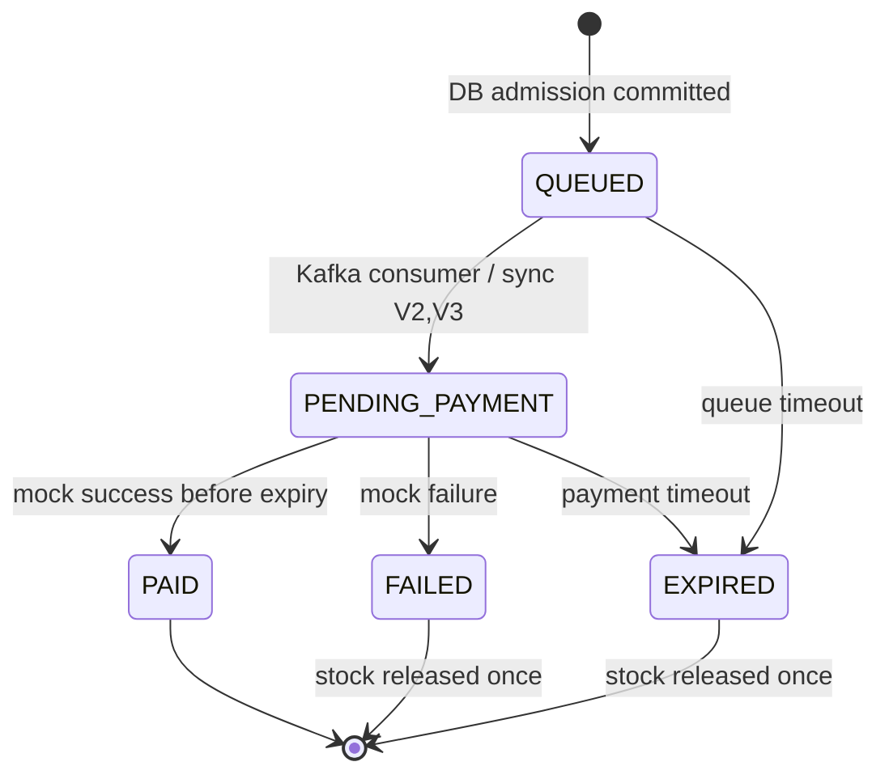

# 架構與資料流

```mermaid
flowchart TD
    C[Client / k6] --> API[Spring Boot API]
    API --> R[Redis Lua advisory admission]
    R --> TX[PostgreSQL transaction]
    TX --> I[Conditional stock UPDATE]
    TX --> Q[Reservation + idempotency key]
    TX --> O[Outbox]
    O --> P[Scheduled publisher]
    P --> K[Kafka ticket-reservations]
    K --> W[Order Consumer]
    W --> D[PostgreSQL orders]
    K --> RT[Retry up to two times]
    RT --> DL[Kafka DLT]
    DL --> DLDB[Persisted dead letters]
    API --> PAY[Mock payment]
    PAY --> D
    EXP[Expiry worker] --> Q
    EXP --> I
    DB[DB stock] --> RC[Periodic Redis projection]
    RC --> R
```

## 承認請求與完成訂單是兩件事

V2／V3 在同一交易保留庫存並同步建立 PENDING_PAYMENT 訂單。最終端點先在 PostgreSQL 原子扣票、建立 QUEUED reservation 與 outbox，再回 202。Kafka 削峰的是後續建單工作；**每次成功保留庫存仍需進 DB**，不宣稱已將所有 DB 熱點移除。

Outbox 的 row lock／SKIP LOCKED 允許多個 publisher 不同時送同一列，但 broker ack 後、DB 標記前崩潰仍可造成重送。Consumer 使用 reservation row lock、狀態檢查與 orders PK 去重。系統採 at-least-once delivery + idempotent business effects，不是跨 DB/Kafka 分散式交易。

## 表

| 表 | 用途／約束 |
| --- | --- |
| tickets | 每活動一列，event_id UNIQUE，remaining 介於 0 與 total_stock |
| reservations | id UUID PK，idempotency_key UNIQUE，綁定 event/user，帶 expiry |
| orders | id 同時是 reservation FK/PK，一個 reservation 至多一單 |
| outbox | 與保留庫存同交易寫入；Kafka ack 後才標記 published_at |
| dead_letters | 保存 DLT payload，提供稽核與人工重送 |

TTL 從 reservation 建立時起算，包含 Kafka 排隊時間，不是在 Consumer 建單後重新計時。付款與 expiry 都先鎖 reservation，狀態 CAS 再釋放票。PAID 不會被晚到的失敗付款或 expiry 釋放。

## 實作導覽

- controller/TicketController、service/TicketService：隔離的 V1。
- finalphase/TicketApi：V2／V3／最終 API 與查詢、付款。
- finalphase/ReservationService：DB 原子扣票、冪等、狀態轉移與稽核。
- finalphase/RedisGate：Lua 檢查、扣減與 token 去重、快取失敗降級。
- finalphase/Messaging、OrderConsumer：topics、重試／DLT、冪等建單。
- finalphase/RecoveryJobs：outbox 重送、expiry、Redis 投影、庫存校正。
- finalphase/AdminApi：token 保護的 audit／repair／DLQ replay。

## 面試展示（60–90 秒）

「我先用 JPA 的讀改寫重現 lost update，100 張票的初版實驗出現 1000 次成功但只扣 54 張。接著用 PostgreSQL 條件式 UPDATE 建立正確性基線，使用資料庫唯一鍵與同 key 的交易鎖避免重複請求建單。

Redis Lua 用於前置原子扣減與攔截，但 DB 仍是最終庫存權威。成功保留庫存時，同一交易建立 outbox，publisher 等 Kafka ack 才標記送出。Consumer 可重送，依 reservation ID 與狀態去重。

付款與到期以列鎖協調，終態只能釋放一次庫存。Kafka 中斷會留在 outbox，Redis 中斷則回退 atomic SQL；DLQ 可人工檢查再重送。新版驗收要看實際 concurrency／故障測試與 k6 守恆數據，目前沒有把未執行的結果或 10 萬次目標說成已達成。」
